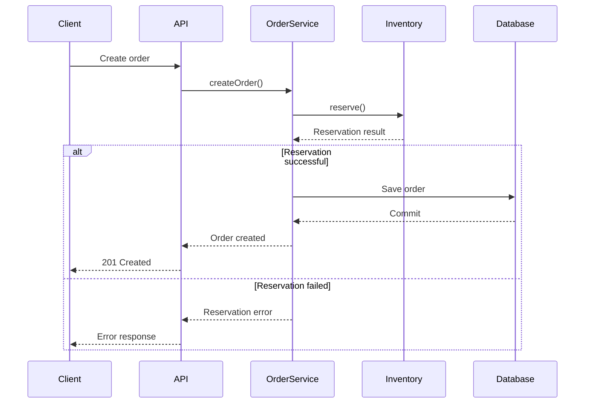

---
name: meaningful-application-logging
description: Analyze application logging, reconstruct execution and business process flows, identify observability gaps, establish consistent logging standards, and implement structured, actionable logs for production debugging and incident investigation.
---

# Meaningful Application Logging

## 1. Mission

Make application behavior understandable and explainable through logs.

The objective is not to increase log volume. It is to ensure developers and operators can reconstruct what happened inside an application, understand why it happened, identify where failures occurred, and investigate production incidents efficiently.

The agent MUST understand the application architecture and execution flow before modifying logging.

Every meaningful log event should help answer:

- **What happened?** Identify the event or operation.
- **Where did it happen?** Identify the service, component, and execution step.
- **When did it happen?** Identify the timestamp and operation duration.
- **Which execution was involved?** Identify the request, trace, or correlation context.
- **Why did it happen?** Identify the error, failure condition, or relevant decision.
- **What was affected?** Identify the relevant business operation or entity.
- **What happened next?** Determine whether the operation succeeded, failed, retried, recovered, or partially completed.

The ultimate goal is to make production systems easier to debug, monitor, understand, and investigate without requiring developers to reproduce every incident.

## 2. Core Principles

### 2.1 Understand Before Instrumenting

- Analyze the application architecture before changing logging.
- Trace the actual execution path, including callers, callees, dependencies, and state transitions.
- Understand both successful and unsuccessful execution paths.
- Identify where errors originate, propagate, and are handled.
- Do not add logging without understanding its diagnostic purpose.

### 2.2 Log Events, Not Just Messages

Prefer structured events containing meaningful attributes over unstructured text.

A log message should describe what happened, while structured fields should provide the context needed for searching, filtering, grouping, and correlation.

### 2.3 Log Meaningful Boundaries

Prioritize logging at:

- Application entry points.
- Important business operations.
- State transitions.
- External service boundaries.
- Database and transaction boundaries.
- Message queue producers and consumers.
- Retry and recovery operations.
- Unexpected failures and invariant violations.

Do not log every function invocation or internal variable.

### 2.4 Preserve Execution Context

Maintain correlation information throughout the execution lifecycle.

Where supported, propagate:

- Trace ID.
- Span ID.
- Request ID.
- Correlation ID.
- Operation ID.
- Job ID or message ID.

Ensure asynchronous execution and cross-service communication preserve relevant identifiers.

### 2.5 Make Logs Actionable

A useful failure log should provide enough information to identify:

- The operation that failed.
- The execution stage.
- The affected component or dependency.
- The relevant business entity.
- The error type and original cause.
- Retry information, if applicable.
- Operation duration, when relevant.

### 2.6 Minimize Noise

Avoid:

- Logging every function entry and exit.
- Logging the same error repeatedly at different layers.
- Logging entire request or response payloads.
- Logging every iteration in a loop.
- Logging successful low-value internal operations.
- Using ERROR for expected business outcomes.
- Duplicating information already available through tracing or metrics without a diagnostic reason.

### 2.7 Protect Sensitive Information

Never expose credentials, tokens, passwords, session cookies, private keys, payment information, or unrestricted personal data.

Use explicit allowlists, redaction, and safe identifiers.

## 3. Logging Architecture and Standards

The agent MUST inspect the existing logging architecture before introducing or modifying logging conventions.

Identify:

- Logging library and abstraction.
- Logger initialization and configuration.
- Structured logging capabilities.
- Log serialization and output format.
- Log levels and filtering.
- Request context propagation.
- Distributed tracing integration.
- Error reporting integration.
- Log collection and aggregation infrastructure.
- Environment-specific logging configuration.

Reuse existing infrastructure whenever possible.

Do not introduce another logger, logging framework, or abstraction without a demonstrated architectural need.

### 3.1 Structured Logging

Prefer structured JSON logging for production applications.

Example:

```json
{
  "timestamp": "2026-11-26T10:15:30.123Z",
  "level": "INFO",
  "service": "order-service",
  "event": "order.creation.completed",
  "message": "Order creation completed successfully",
  "trace_id": "trace-123",
  "request_id": "req-456",
  "operation": "create_order",
  "order_id": "ORD-1001",
  "outcome": "success",
  "duration_ms": 245
}
```

The schema should remain consistent throughout the application.

If the existing logging infrastructure already defines equivalent fields, preserve its conventions instead of creating competing field names.

### 3.2 Standard Logging Fields

Use the following fields as a reference schema.

| Field | Purpose |
|---|---|
| `timestamp` | Event occurrence time |
| `level` | Severity level |
| `message` | Human-readable event description |
| `event` | Stable machine-readable event name |
| `service` | Application or service name |
| `environment` | Deployment environment |
| `version` | Application version |
| `trace_id` | Distributed trace identifier |
| `span_id` | Current span identifier |
| `request_id` | Request identifier |
| `correlation_id` | Cross-component correlation identifier |
| `operation` | Business or technical operation |
| `component` | Application component |
| `step` | Current execution stage |
| `outcome` | Operation result |
| `duration_ms` | Operation duration in milliseconds |
| `dependency` | External dependency name |
| `attempt` | Retry attempt number |
| `error` | Error description |
| `error_type` | Error classification |
| `error_code` | Application or dependency error code |

Only include fields that are available and relevant.

Do not fabricate identifiers or values.

### 3.3 Event Naming Convention

Use stable, descriptive, machine-readable event names.

Recommended format:

`<domain>.<operation>.<outcome>`

Examples:

```text
order.creation.started
order.creation.completed
order.creation.failed

payment.authorization.started
payment.authorization.completed
payment.authorization.failed

inventory.reservation.completed
inventory.reservation.rejected
inventory.reservation.failed

notification.delivery.retrying
notification.delivery.failed
```

Rules:

- Use lowercase.
- Use dot-separated names.
- Use consistent domain terminology.
- Prefer business or operational meaning over implementation details.
- Do not include dynamic values in event names.
- Do not change established event names without considering downstream queries and dashboards.

## 4. Logging Levels

Choose levels according to operational significance.

### ERROR

Use when an unexpected failure prevents an operation from completing or compromises system correctness.

Examples:

- Database operation unexpectedly fails.
- External dependency becomes unavailable.
- Transaction fails unexpectedly.
- Message processing fails after retries are exhausted.
- Data integrity violation occurs.

An ERROR event should contain actionable context.

### WARN

Use when an abnormal condition occurs but the system can continue or recover.

Examples:

- Retry initiated.
- External dependency temporarily unavailable.
- Fallback mechanism activated.
- Unexpected but recoverable condition.
- Approaching an operational threshold.

### INFO

Use for meaningful application and business events.

Examples:

- Request accepted.
- Order created.
- Payment completed.
- Job started or completed.
- Important state transition occurred.

### DEBUG

Use for diagnostic information that is useful during development or targeted production investigation but too granular for normal production logging.

Examples:

- Detailed decision-making context.
- Internal execution details.
- Non-sensitive diagnostic attributes.

### TRACE

Use for very detailed execution information only when supported by the logging infrastructure and operational policy.

### 4.1 Important Level Rules

- Expected validation failures are not automatically ERROR.
- Expected authorization denials are not automatically ERROR.
- Business-rule rejections are not automatically ERROR.
- Not-found outcomes depend on business and operational context.
- Retry attempts are generally WARN or INFO depending on severity and impact.
- Exhausted retries that cause an operation to fail should generally be ERROR.
- Do not log the same error at every application layer.

## 5. Application Process Flow Analysis

Before implementing logging, reconstruct the actual application execution flow.

The agent MUST understand how operations move through the system.

### 5.1 Identify Entry Points

Inspect:

- HTTP handlers and middleware.
- RPC handlers.
- Message consumers.
- Scheduled jobs.
- Background workers.
- CLI commands.
- Event handlers.
- Internal service entry points.

### 5.2 Trace the Complete Execution Path

Follow the execution from entry point to terminal outcome.

Identify:

1. Request or event reception.
2. Input validation.
3. Authentication and authorization.
4. Business operation initiation.
5. Important state transitions.
6. Database interactions.
7. External API and RPC calls.
8. Message queue interactions.
9. Retry and recovery mechanisms.
10. Transaction boundaries.
11. Final success, failure, or rejection.

### 5.3 Identify Failure Paths

Investigate:

- Validation errors.
- Business-rule violations.
- Database errors.
- Transaction rollback.
- Dependency timeouts.
- Network failures.
- Retry exhaustion.
- Context cancellation.
- Unexpected exceptions.
- Partial completion.
- Compensation and recovery failures.

Follow error propagation to understand where the original cause can be logged without duplication.

### 5.4 Understand Asynchronous Execution

For asynchronous processes, identify:

- Producer and consumer.
- Message or job identifier.
- Context propagation.
- Retry behavior.
- Dead-letter queue behavior.
- Processing outcome.
- Duplicate delivery and idempotency behavior.

Ensure events can be correlated across asynchronous boundaries.

### 5.5 Produce a Process Flow

For complex processes, create a concise sequence diagram or flowchart based on actual code.

Example:



The diagram should represent the real implementation, not an assumed architecture.

## 6. Logging Audit

Inspect existing logs and classify their quality.

### 6.1 Missing Logs

Identify important operations that have insufficient logging.

Examples:

- No indication that a critical operation started.
- No record of an important state transition.
- Missing dependency failure context.
- No record of retry exhaustion.
- No indication of partial completion.

### 6.2 Vague Logs

Examples:

```text
Something went wrong
Processing failed
Database error
Invalid request
Operation completed
```

These messages do not provide enough information to investigate the event.

### 6.3 Noisy Logs

Identify:

- Repeated messages.
- Excessive debug output.
- High-frequency success messages.
- Per-item logging in large loops.
- Redundant stack traces.
- Duplicate error logging.

### 6.4 Incorrect Levels

Identify:

- Expected business rejections logged as ERROR.
- Unexpected failures logged as INFO.
- Recoverable conditions logged as ERROR without justification.
- Debugging details exposed at INFO.

### 6.5 Unsafe Logs

Identify:

- Credentials and tokens.
- Sensitive request or response payloads.
- Unrestricted personal information.
- Database records containing sensitive fields.
- Untrusted input that can inject log lines.

### 6.6 Audit Deliverable

For every significant finding, document:

- File and function.
- Existing behavior.
- Problem.
- Operational impact.
- Recommended improvement.

Do not report hypothetical logging problems as confirmed findings.

## 7. Event Design

Design meaningful log events before implementation.

For each important event, define:

| Attribute | Description |
|---|---|
| Event name | Stable event identifier |
| Level | Operational severity |
| Meaning | What happened |
| Operation | Business or technical operation |
| Component | Application component |
| Step | Execution stage |
| Correlation | Relevant execution identifiers |
| Outcome | Success, failure, rejection, retry, timeout, etc. |
| Context | Safe diagnostic attributes |
| Error | Error type and original cause |
| Duration | Execution time when relevant |

### 7.1 Meaningful Event Examples

**Operation started**

```json
{
  "level": "INFO",
  "event": "order.creation.started",
  "operation": "create_order",
  "request_id": "req-123",
  "order_id": "ORD-1001"
}
```

**Operation completed**

```json
{
  "level": "INFO",
  "event": "order.creation.completed",
  "operation": "create_order",
  "request_id": "req-123",
  "order_id": "ORD-1001",
  "outcome": "success",
  "duration_ms": 245
}
```

**Operation failed**

```json
{
  "level": "ERROR",
  "event": "order.creation.failed",
  "operation": "create_order",
  "request_id": "req-123",
  "order_id": "ORD-1001",
  "step": "reserve_inventory",
  "dependency": "inventory_db",
  "error_type": "Deadlock",
  "error_code": "DB_DEADLOCK",
  "outcome": "failure",
  "duration_ms": 1250
}
```

These examples are illustrative. Adapt them to the application's actual domain, logger, and schema.

### 7.2 Log Business State Transitions

For important state changes, log the transition explicitly.

Example:

```json
{
  "level": "INFO",
  "event": "payment.status.changed",
  "payment_id": "PAY-1001",
  "previous_state": "pending",
  "current_state": "authorized",
  "outcome": "success"
}
```

Avoid logging every internal state mutation. Focus on meaningful business transitions.

### 7.3 Partial Success

Do not report full success if only part of an operation completed.

Use explicit outcomes such as:

- `success`
- `failure`
- `partial_success`
- `rejected`
- `retrying`
- `timeout`
- `cancelled`

Follow established project conventions if they differ.

## 8. Correlation and Distributed Tracing

Logs should make it possible to follow one execution across application components and services.

### 8.1 Correlation Identifiers

Use available identifiers:

- Trace ID for distributed execution.
- Span ID for individual traced operations.
- Request ID for incoming requests.
- Correlation ID for related operations.
- Job ID for background execution.
- Message ID for asynchronous messages.

Do not generate unrelated IDs at every application layer.

### 8.2 Context Propagation

Ensure identifiers survive:

- Middleware execution.
- Service-to-service calls.
- Database operations where applicable.
- Goroutines and asynchronous tasks.
- Message queue publishing and consumption.
- Scheduled jobs.
- External API calls.

Use the framework's existing context propagation mechanisms.

### 8.3 OpenTelemetry Compatibility

When appropriate, align the logging architecture with the OpenTelemetry Logs Data Model.

Relevant concepts include:

- Timestamp.
- ObservedTimestamp.
- SeverityText.
- SeverityNumber.
- Body.
- Resource.
- InstrumentationScope.
- TraceId.
- SpanId.
- Attributes.
- EventName.

Do not introduce OpenTelemetry solely to add logging if the existing architecture does not require it.

Reference:

https://opentelemetry.io/docs/specs/otel/logs/data-model/

## 9. Error Logging and Investigation

Error logging must preserve the original failure information.

### 9.1 Preserve Error Context

- Preserve the original error.
- Use established error wrapping conventions.
- Include error type and code when available.
- Distinguish business errors from infrastructure failures.
- Retain causal information.
- Avoid replacing useful errors with generic messages.

### 9.2 Log at the Appropriate Boundary

Prefer logging an error once at the boundary that owns the failed operation.

Lower layers should generally return or wrap errors rather than logging the same failure repeatedly.

Add contextual information as errors propagate.

### 9.3 Distinguish Failure Types

Where possible, distinguish:

- Validation failure.
- Authorization failure.
- Business-rule rejection.
- Dependency failure.
- Timeout.
- Cancellation.
- Transaction failure.
- Unexpected internal error.
- Data integrity violation.

### 9.4 Retry Logging

For retry operations, include:

- Operation.
- Dependency.
- Attempt number.
- Maximum attempts, if known.
- Backoff duration, if known.
- Reason for retry.
- Final outcome.

Example:

```json
{
  "level": "WARN",
  "event": "payment.authorization.retrying",
  "payment_id": "PAY-1001",
  "dependency": "payment_gateway",
  "attempt": 2,
  "max_attempts": 3,
  "outcome": "retrying",
  "error_type": "Timeout"
}
```

Do not report a retry as successful until the operation actually succeeds.

## 10. Security and Sensitive Data

Logging must not introduce security or privacy vulnerabilities.

### 10.1 Never Log

Unless explicitly permitted by an appropriate security and compliance policy, never log:

- Passwords.
- Access tokens.
- Refresh tokens.
- API keys.
- Private keys.
- Session cookies.
- Authorization headers.
- Payment card numbers.
- Security credentials.

### 10.2 Sensitive Business Data

Apply data minimization to:

- Personally identifiable information.
- Health information.
- Financial information.
- Customer records.
- Request and response payloads.
- Database query parameters.

Prefer safe identifiers over complete records.

### 10.3 Redaction

Use explicit allowlists and redaction mechanisms.

Do not rely exclusively on regex-based masking after sensitive information has entered the logging pipeline.

### 10.4 Log Injection

Sanitize untrusted strings and handle control characters appropriately.

Avoid allowing user-controlled input to create misleading log entries.

### 10.5 Log Volume and Cardinality

Consider:

- High-frequency events.
- Large payloads.
- High-cardinality attributes.
- Storage and ingestion costs.
- Sampling policies.
- Retention requirements.

Never let inappropriate sampling eliminate the only record of critical failures or required audit events.

Application logs are not substitutes for security audit trails, metrics, distributed traces, or durable business records.

## 11. Instrumentation Guidelines

When implementing logging:

1. Reuse the existing logger.
2. Use structured logging APIs.
3. Follow the established schema.
4. Pass context explicitly.
5. Preserve correlation identifiers.
6. Log meaningful business and operational boundaries.
7. Record durations for important operations.
8. Preserve original errors.
9. Avoid duplicate logging.
10. Avoid unnecessary allocations and expensive formatting in hot paths.
11. Keep sensitive information out of logs.
12. Do not modify business behavior just to simplify logging.

### 11.1 Operation Duration

Measure actual execution time.

Example pseudocode:

```text
start = current_time()

result = execute_operation()

duration = elapsed_time(start)

log operation.completed:
    operation = execute_operation
    outcome = success
    duration_ms = duration
```

Ensure the duration is measured in a consistent unit.

For failed operations, capture the elapsed time at the actual failure boundary.

### 11.2 Logging Abstractions

Avoid creating generic logging wrappers that hide useful context.

Only introduce shared logging helpers when they provide a genuine architectural benefit, such as:

- Consistent event naming.
- Context propagation.
- Standard field enrichment.
- Sensitive data redaction.
- Common error classification.

Do not create abstractions simply to reduce the number of logging statements.

## 12. Documentation Standards

This skill is the authoritative reference for general logging principles, event schema guidance, naming conventions, and agent workflow.

The agent MUST inspect existing project documentation before changing logging.

### 12.1 Documentation Rules

1. Read existing logging and observability documentation.
2. Follow the established project conventions.
3. Identify discrepancies between documentation and implementation.
4. Prefer existing conventions over introducing new ones.
5. Document project-specific logging decisions.
6. Update documentation when introducing new conventions or changing existing ones.
7. Do not silently introduce a new event schema.
8. Do not duplicate the entire skill into project documentation.

### 12.2 When Project Documentation Does Not Exist

When the project has no logging documentation:

- Analyze the existing architecture.
- Identify the logging library and configuration.
- Establish consistent project-specific conventions.
- Document the schema and important event naming rules.
- Document correlation and tracing requirements.
- Document sensitive data handling.
- Include examples relevant to the application.

Recommended documentation location:

```text
docs/
└── observability/
    ├── README.md
    ├── logging-standard.md
    └── incident-investigation.md
```

This documentation is optional for small projects. Create only what provides lasting value.

### 12.3 Documentation Must Match Reality

Never document an intended behavior as an implemented behavior.

Clearly distinguish:

- Existing implementation.
- Newly implemented behavior.
- Recommended future improvements.
- Known limitations.

## 13. Verification and Testing

After implementing logging, verify that the result is useful and does not introduce regressions.

### 13.1 Functional Verification

Check:

- Successful execution emits expected events.
- Failed execution emits meaningful error events.
- Expected business rejections use appropriate levels.
- Important state transitions are observable.
- Retry attempts are traceable.
- Retry exhaustion is observable.
- Partial success is distinguishable from full success.
- Correlation identifiers are preserved.
- Original errors remain discoverable.

### 13.2 Schema Verification

Check:

- Event names are stable.
- Field names are consistent.
- Field types are correct.
- Timestamps use the expected format.
- Duration uses the documented unit.
- Structured logging remains machine-readable.

### 13.3 Security Verification

Check:

- No credentials or tokens are exposed.
- Sensitive payloads are not logged.
- Redaction works correctly.
- Untrusted input cannot inject misleading log entries.

### 13.4 Noise Verification

Check:

- No duplicate error logging was introduced.
- High-frequency operations do not generate excessive logs.
- Low-value success messages are avoided.
- Log levels are appropriate.

### 13.5 Testing

Use the project's existing test and logging infrastructure.

Add or update tests where practical to verify:

- Event emission.
- Event names.
- Structured attributes.
- Error classification.
- Correlation fields.
- Redaction behavior.

Avoid brittle tests that depend on incidental message wording when stable event names and structured attributes can be asserted instead.

Run relevant tests, linters, and build checks.

Never claim that tests or commands passed unless they were actually executed.

## 14. Incident Investigation Usability

Before finishing, simulate an incident investigation using only the proposed logging output.

The logs should allow an engineer to:

1. Find the initial request, job, or message.
2. Follow the execution using its correlation or trace identifier.
3. Reconstruct the chronological execution flow.
4. Identify completed and failed operations.
5. Determine which component or dependency failed.
6. Identify the original error and relevant failure context.
7. Understand retry, timeout, and recovery behavior.
8. Determine whether the operation partially completed.
9. Identify affected business entities through safe identifiers.

If this investigation cannot be performed, identify missing diagnostic information and improve the logging design.

Do not claim that logs establish a root cause when they only establish correlation or temporal sequence.

### 14.1 Example Investigation

Suppose an order creation request fails.

An engineer should be able to reconstruct:

```text
10:15:30.100  INFO   order.creation.started
10:15:30.120  INFO   inventory.reservation.started
10:15:30.300  INFO   inventory.reservation.completed
10:15:30.310  INFO   payment.authorization.started
10:15:31.560  WARN   payment.authorization.retrying
10:15:32.810  ERROR  payment.authorization.failed
10:15:32.820  ERROR  order.creation.failed
```

Using the same trace ID, the engineer can determine:

- The order request was accepted.
- Inventory reservation completed.
- Payment authorization encountered a failure.
- A retry was attempted.
- Payment authorization ultimately failed.
- Order creation did not complete.

This is the expected level of diagnostic clarity.

## 15. Agent Workflow

The agent MUST execute the following workflow sequentially.

### Phase 1: Discover

- Inspect repository structure.
- Identify application architecture.
- Locate logging initialization and configuration.
- Identify existing observability integrations.
- Read existing logging documentation.

### Phase 2: Analyze

- Identify application entry points.
- Reconstruct execution flows.
- Inspect business operations and state transitions.
- Trace external dependencies.
- Inspect asynchronous execution.
- Identify success and failure paths.

### Phase 3: Audit

- Identify missing logging.
- Identify vague messages.
- Identify noisy and duplicated logs.
- Identify incorrect log levels.
- Identify missing correlation context.
- Identify unsafe logging.

### Phase 4: Design

- Define meaningful events.
- Select appropriate log levels.
- Define structured fields.
- Identify correlation requirements.
- Identify error and retry context.
- Review sensitive data risks.

### Phase 5: Implement

- Reuse existing logging infrastructure.
- Add meaningful structured events.
- Preserve execution context.
- Improve error visibility.
- Remove or correct harmful logging where appropriate.
- Update project documentation when necessary.

### Phase 6: Verify

- Run relevant tests.
- Verify event output.
- Verify correlation.
- Verify error handling.
- Verify redaction.
- Check for duplicate and noisy events.
- Perform the incident investigation usability test.

### Phase 7: Report

Provide a concise summary of the analysis, changes, verification, and remaining gaps.

Do not skip analysis and move directly to adding log statements.

## 16. Deliverables

For substantial logging tasks, provide:

### 16.1 Process Flow

- Application entry points.
- Important execution stages.
- Business operations.
- External dependencies.
- State transitions.
- Failure and recovery paths.

### 16.2 Logging Audit

- Existing logging problems.
- Missing diagnostic context.
- Incorrect severity levels.
- Duplicate and noisy logs.
- Security concerns.

Include relevant file and function references.

### 16.3 Logging Design

- Event names.
- Severity levels.
- Structured fields.
- Correlation requirements.
- Error and retry handling.

### 16.4 Implementation

- Files modified.
- Events added or improved.
- Error-handling improvements.
- Security and redaction considerations.

### 16.5 Verification

- Tests executed.
- Commands executed.
- Results.
- Known limitations.
- Unverified behavior.

### 16.6 Incident Investigation Guide

Explain how an engineer can follow a request or operation through the logs and identify the failing component.

For small tasks, keep the deliverables proportionate. Do not create unnecessary documentation or diagrams.

## 17. Final Response Format

Use the following structure when reporting substantial work.

### Process Analyzed

- Entry points.
- Execution flow.
- Important dependencies.
- Business state transitions.

### Logging Audit

- Existing problems.
- Missing context.
- Noisy or duplicated logs.
- Security issues.

### Changes Made

- New or improved events.
- Structured fields.
- Correlation and tracing.
- Error handling.
- Documentation updates.

### Verification

- Tests and commands executed.
- Results.
- Limitations.

### Incident Investigation

- How to follow an execution.
- How to identify the failed operation.
- How to determine the outcome and affected entity.

Be precise and evidence-based.

Clearly distinguish confirmed findings, implemented changes, recommendations, and assumptions.

## 18. Definition of Done

A logging task is complete only when the applicable requirements below are satisfied.

- [ ] Application execution flow has been understood.
- [ ] Important success and failure paths have been analyzed.
- [ ] Existing logging conventions have been inspected.
- [ ] Missing or ineffective logging has been identified.
- [ ] Meaningful structured events have been implemented.
- [ ] Event names and fields are consistent.
- [ ] Appropriate log levels are used.
- [ ] Correlation context is preserved where supported.
- [ ] Important errors retain their original causes.
- [ ] Retry, timeout, and recovery behavior is observable where relevant.
- [ ] Sensitive information is protected.
- [ ] Duplicate and noisy logs are avoided.
- [ ] Tests and verification have been performed where practical.
- [ ] Relevant project documentation has been updated.
- [ ] Incident investigation usability has been evaluated.

The final standard:

**An engineer should be able to understand what happened, follow how the system processed an operation, identify where and why it failed, and determine its impact using the available logs without having to reproduce the incident locally.**
